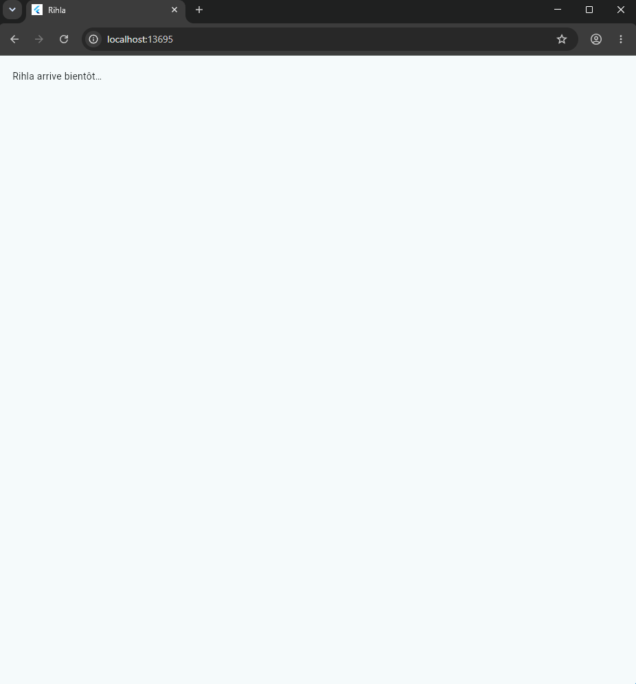
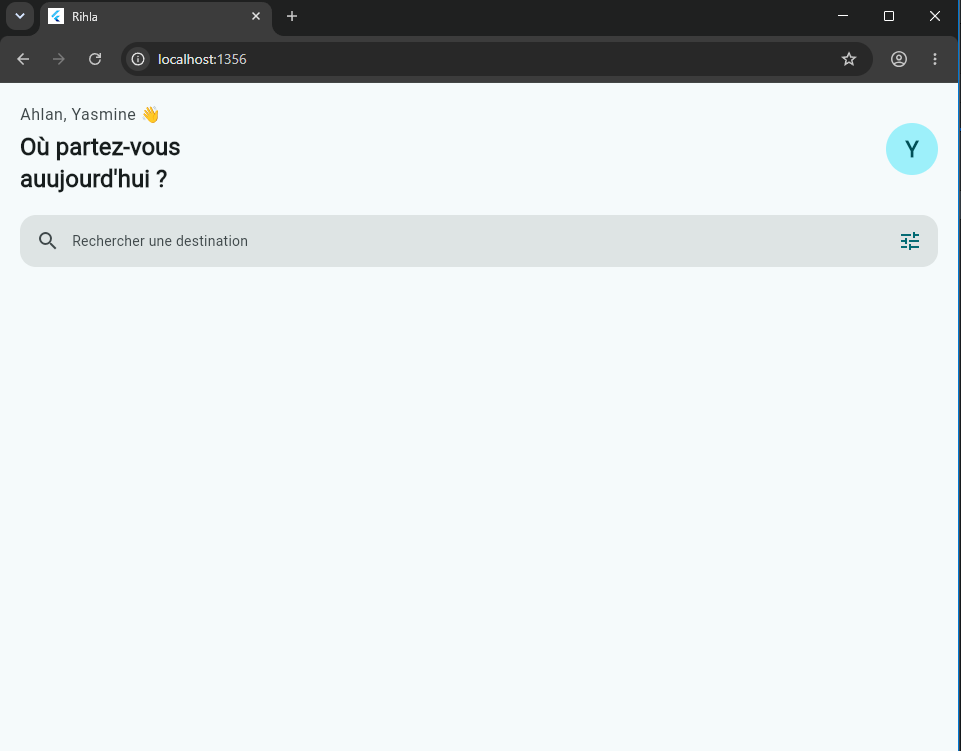
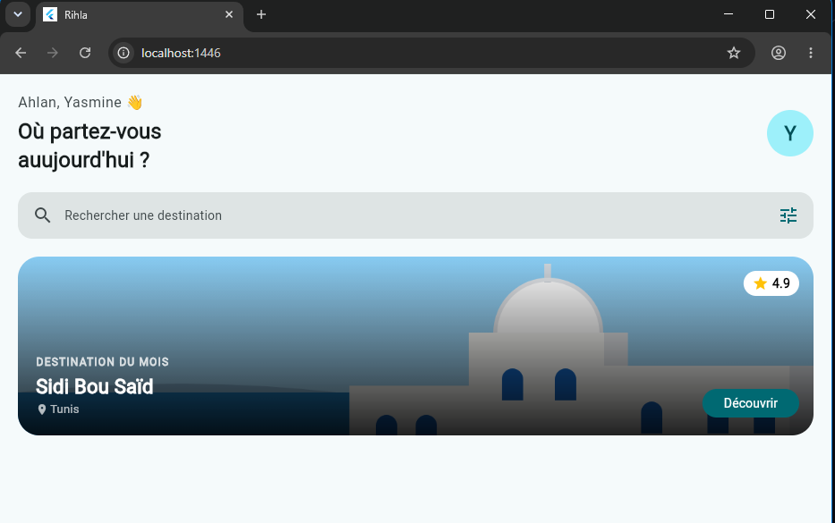
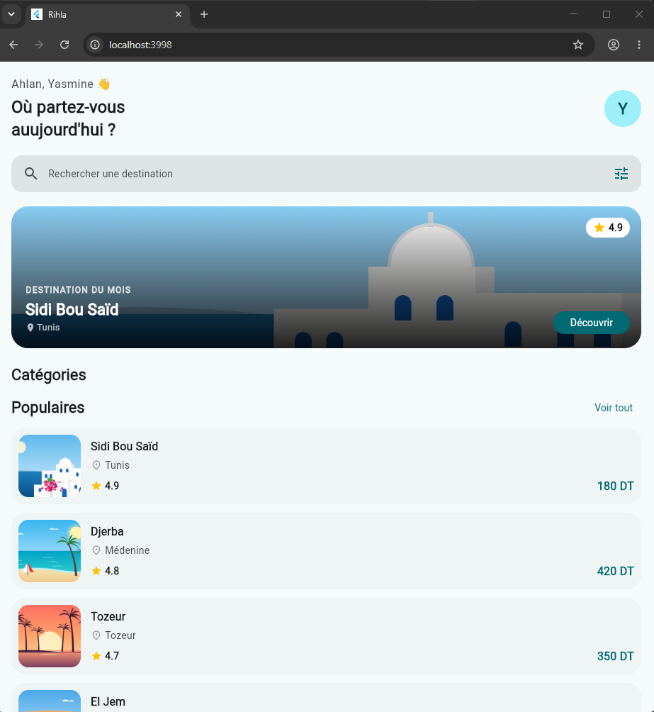
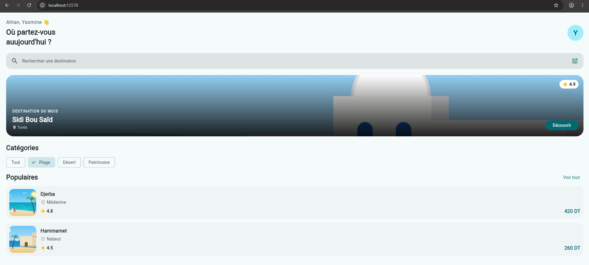
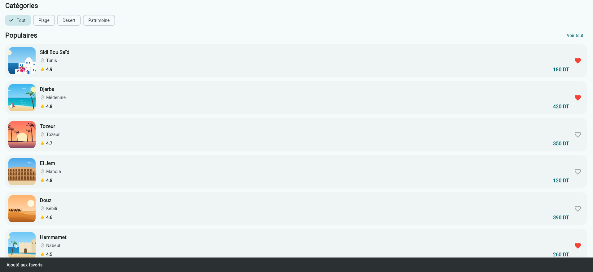
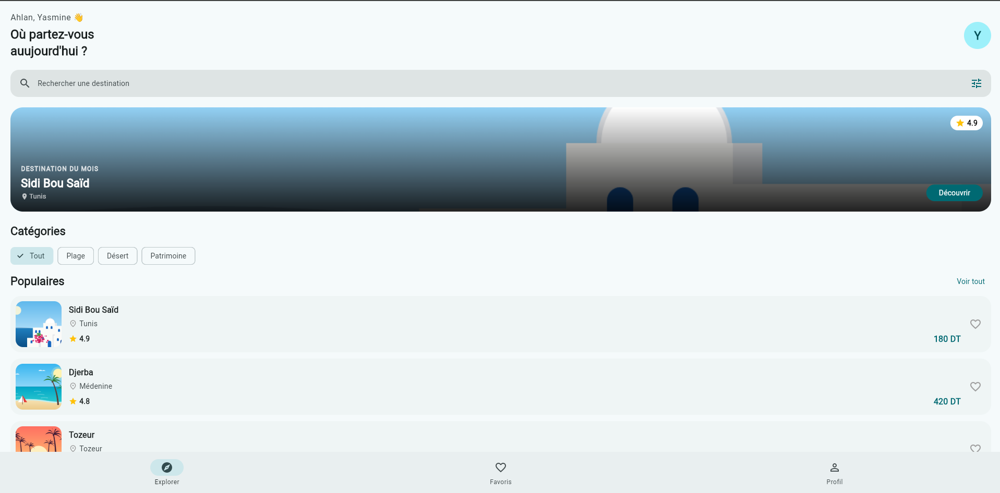
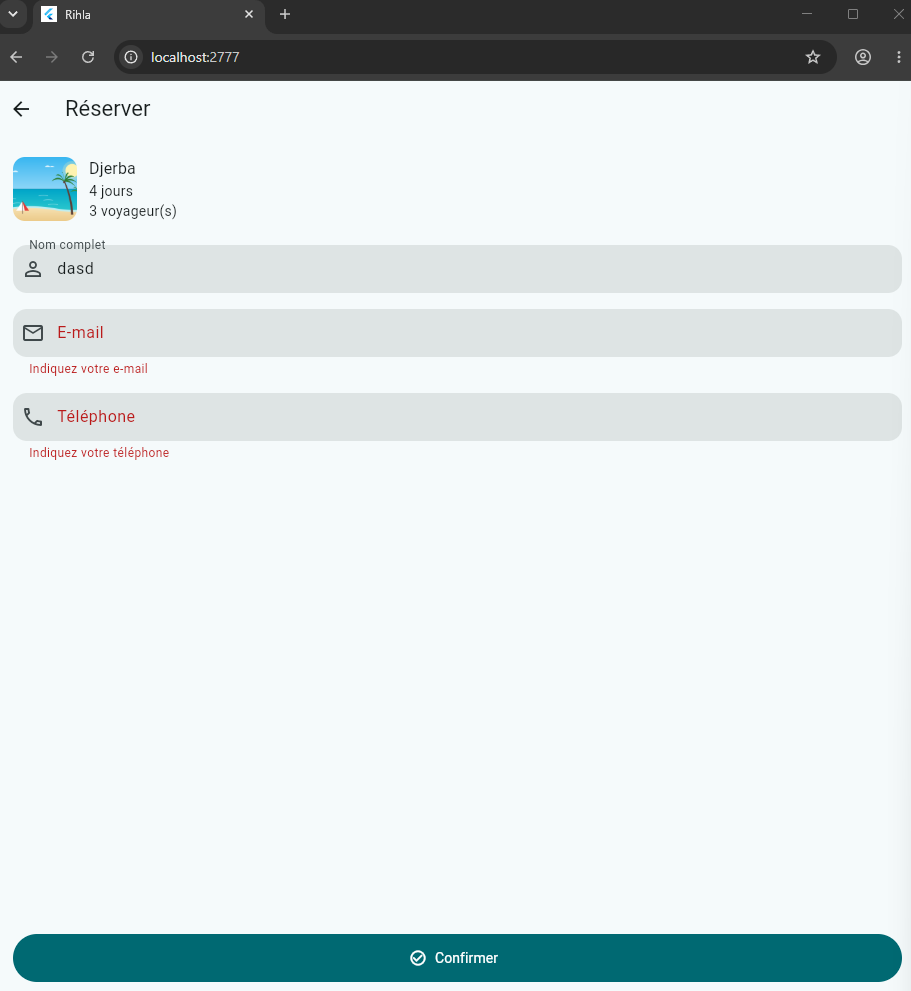
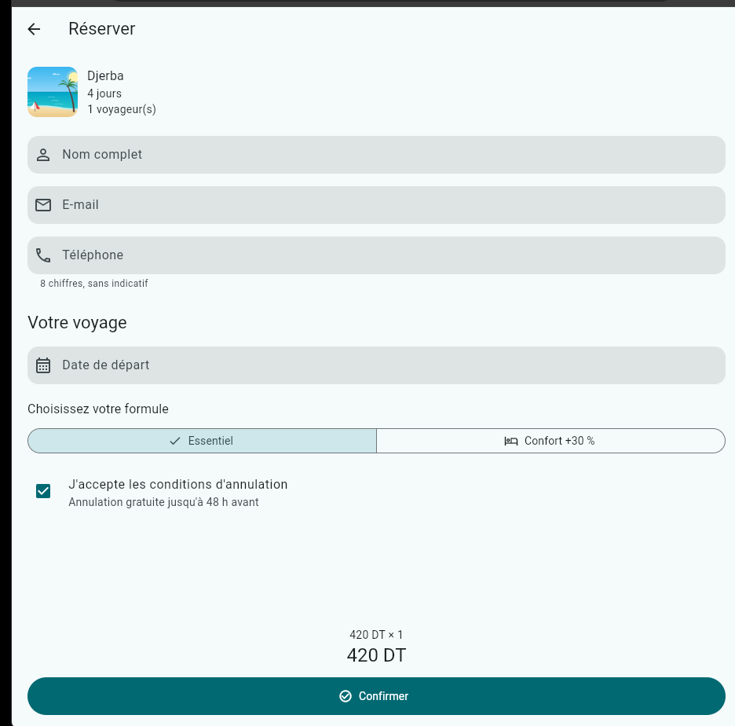

# rehla
palier1:

palier2:

Réponse 1: 
L'avatar se colle juste à côté du texte au lieu d'être à droite. 
Sans Expanded, la Column ne prend pas toute la largeur disponible pour pousser l'avatar.

Réponse 2: 
Parce que StatelessWidget est immuable. Ses variables doivent être `final` et ne changent pas.

Réponse 3: 
- Colors.teal : Couleur fixe.
- cs.primary : Couleur dynamique qui change automatiquement avec la seedColor du thème.

palier3:

Réponse 1: 
L'image va couvrir le dégradé et le texte sera difficile à lire. 
Dans un Stack, les enfants sont superposés (le dernier est au premier plan).

Réponse 2: 
L'image perd ses coins arrondis et devient un rectangle carré.

Réponse 3: 
Pour réserver de l'espace à droite afin que le texte ne se superpose pas avec le bouton "Découvrir".

palier4:

Réponse 1: 
Parce que le Spacer a besoin de savoir qu'il y a un espace disponible fini pour s'étendre. Sans Expanded, la Column a une hauteur/largeur infinie ou non contrainte horizontalement.

Réponse 2: 
Aucune ligne de code à ajouter ! Il suffit d'ajouter la 7e destination dans le fichier `lib/data/destinations.dart` et la boucle `for` s'en chargera automatiquement.

palier5:

Réponse 1: 
À l'écran, rien ne change (la vue ne se met pas à jour). En mémoire, la variable _categorie change bien de valeur, mais Flutter n'est pas notifié qu'il doit redessiner (re-builder) l'interface.

Réponse 2: 
Pour qu'à chaque fois que setState() s'exécute et que l'écran se re-construit, la liste soit filtrée dynamiquement en fonction de la nouvelle valeur de   categorie.

Réponse 3: 
Parce que HeroBanner affiche une destination fixe (ici destinations.first) et n'a pas besoin de gérer d'état interne changeant lors du filtrage.

palier6:

palier7:

S4 Navigation

palier 2:
Q1:
Oui, le filtre est conservé.
HomeScreen reste dans la pile lorsque Navigator.push()
ouvre DetailScreen. Navigator.pop() retire DetailScreen
et affiche le même HomeScreen avec son état précédent.

Q2:
DetailScreen reçoit la destination à travers son constructeur.
Ce mécanisme réutilise le passage de données entre écrans
par les paramètres du constructeur, étudié dans le TP3.

Q3:
Sans clipBehavior, l'effet visuel du InkWell peut dépasser
les coins arrondis de la carte.
Clip.antiAlias permet de respecter la forme arrondie.

Palier 3:

Q1 :

_formKey.currentState!.validate() vérifie tous les champs du formulaire en exécutant leurs fonctions validator.

Elle renvoie true si tous les champs sont valides, sinon false. Les messages d'erreur s'affichent sous les champs incorrects.

Q2 :

inputFormatters contrôle la saisie pendant que l'utilisateur tape. Il empêche les lettres et limite le téléphone à 8 chiffres.

validator vérifie la valeur saisie lors de la validation du formulaire et affiche un message d'erreur si elle est incorrecte.

Q3 :

dispose() permet de libérer les ressources utilisées par les TextEditingController lorsque l'écran est détruit.

Cela évite de conserver inutilement des ressources en mémoire.

palier 4:

Q1 :
Le champ date est en readOnly pour empêcher l'utilisateur de saisir manuellement une date avec le clavier. Il doit choisir une date à partir du calendrier (showDatePicker). Cela garantit un format de date correct et évite les erreurs de saisie. Sans readOnly, l'utilisateur pourrait écrire une date incorrecte ou dans un format non valide.

Q2:
_total est un getter qui calcule automatiquement le prix total à partir du prix par personne et du nombre de voyageurs. Lorsque la formule change, setState() reconstruit l'interface et le getter est recalculé automatiquement avec la nouvelle valeur de _prixParPersonne. Il n'est donc pas nécessaire de mettre à jour _total